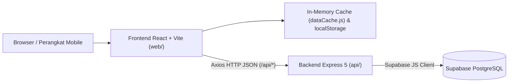
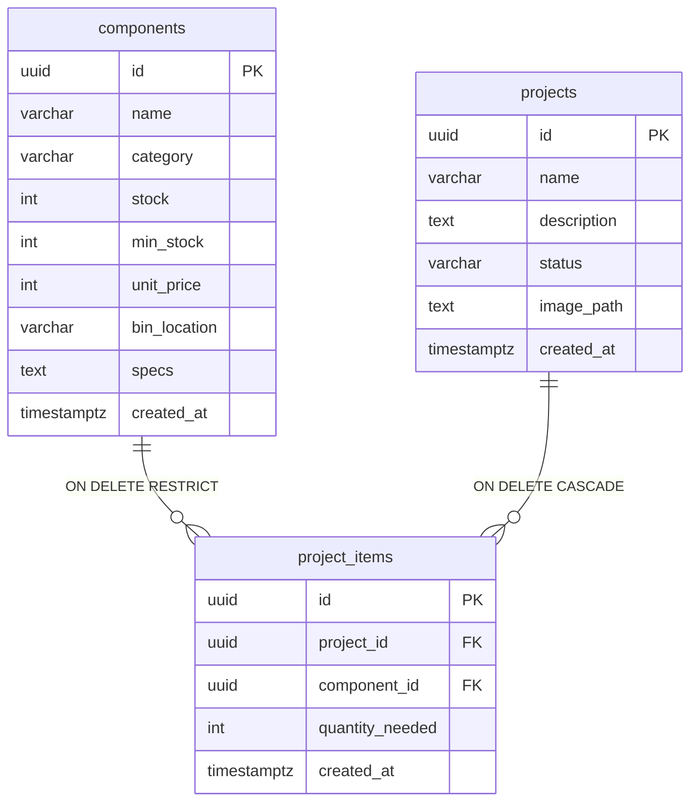

# PartsBin — Katalog Komponen Mikro & Kalkulator BOM Proyek Elektronika

**Tugas Akhir Praktikum Pemrograman Perangkat Bergerak (PPB) Ganjil 2026**

- **Pembuat**: Robertus William Susanto (`21120124120007`)
- **Program Studi**: Teknik Komputer, Universitas Diponegoro
- **Repositori GitHub**: https://github.com/RobertusWilliamSusanto/partsbin
- **URL Produksi Frontend**: https://partsbin-web.vercel.app
- **URL Produksi Backend API**: https://partsbin-api.vercel.app/api

---

## 1. Deskripsi Aplikasi

PartsBin adalah aplikasi web responsif berbasis React + Vite dan Express 5 + Supabase (PostgreSQL) untuk mengelola inventaris komponen elektronika pribadi (lokasi laci, jumlah stok, stok minimum, harga satuan, dan spesifikasi teknis) yang terintegrasi langsung dengan kalkulator **Bill of Materials (BOM)** proyek elektronika.

Sistem desain menggunakan pendekatan **Technician's Bench Notebook** (*Precision Cobalt Slate*, mode terang/gelap bebas kedip, kontras WCAG AA/AAA >= 4.5:1, permukaan solid bebas beban GPU, dan dual-layout Mobile `< 768px` serta Desktop `>= 768px`).

---

## 2. Fitur Utama & Kalkulator BOM

1. **Dashboard Meja Kerja (`/`)**: Menampilkan seluruh daftar proyek dengan filter status live (Semua, Direncanakan, Dikerjakan, Selesai; tersinkronisasi `?status=`), kartu proyek dengan thumbnail rasio 4:3 (`ProjectCover`), `StatusChip`, progress bar kesiapan rakit BOM, dan pagination client-side (`pageSize: 6`).
2. **Katalog Komponen (`/components`) & Detail (`/components/:id`)**:
   - Pencarian & filter kategori + filter "Stok Menipis" secara instan di browser (*client-side filtering*).
   - Stepper koreksi stok cepat `-1 / +1` melalui `PATCH /api/components/:id/stock`.
   - Panel form inline collapsible (`ComponentInlineForm.jsx`) dengan auto-save draf ter-debounce 400ms (`localStorage`) pada mode tambah serta inline edit pada halaman detail.
   - Proteksi `ON DELETE RESTRICT` (`409 Conflict`) bila komponen masih terdaftar pada BOM proyek, lengkap dengan daftar `used_in_projects`.
   - Pagination client-side (`usePagination`, `pageSize: 6`, tersinkronisasi `?page=`).
3. **Kalkulator BOM (`/calculator`) & Detail Proyek (`/projects/:id`)**:
   - **Perencanaan Proyek & BOM (`/calculator`)**: Pemilihan komponen inventaris + jumlah kebutuhan dengan live kalkulasi estimasi biaya dan kesiapan rakit BOM.
   - **Detail Proyek (`/projects/:id`)**: Dokumentasi sampul rasio 4:3 (`ProjectCover`), pengubah status pengerjaan fisik 3 tombol (`planned`, `in_progress`, `done`), kartu kesiapan rakit (*Build Readiness %*), daftar item BOM, penambahan item komponen, dan kartu daftar belanja (*Shopping Deficit*).
   - Rute `/projects` dialihkan otomatis (`Navigate replace`) ke `/`.
   - **Kalkulator Kesiapan Rakit (*Build Readiness %*) & Daftar Belanja (*Shopping Deficit*)**:
     - `is_low_stock = stock <= min_stock`
     - `shortage_qty = Math.max(0, quantity_needed - stock_available)`
     - `is_enough = shortage_qty === 0`
     - `readiness_percent = total_items === 0 ? 0 : Math.round((ready_items_count / total_items) * 100)`
     - `total_bom_cost = sum(quantity_needed * unit_price)`
     - `missing_cost = sum(shortage_qty * unit_price)`
   - Inline edit informasi proyek, tambah/hapus item BOM, serta konfirmasi hapus destruktif melalui `ConfirmModal.jsx`.
4. **Profil & Tentang (`/profile`)**: Identitas pembuat, kontrol tema terang/gelap, status koneksi jaringan (`useOnlineStatus`), status draf tersimpan, serta ringkasan arsitektur dan rumus BOM.
5. **Sinkronisasi Cache Lintas-Hook (`dataCache.js`)**: Setiap mutasi stok/data komponen otomatis meng-invalidasi cache proyek (agar `readiness_percent` dan `shopping_list` selalu akurat saat pindah tab), dan setiap mutasi proyek/item BOM otomatis meng-invalidasi cache detail komponen (`used_in_projects`).

---

## 3. Arsitektur Sistem & ERD

### Diagram Arsitektur



### Entity Relationship Diagram (3 Tabel)



---

## 4. Struktur Folder Monorepo

```text
partsbin/
├── .gitignore
├── README.md
├── api/
│   ├── sql/
│   │   ├── schema.sql
│   │   ├── seed.sql
│   │   └── migration_v4.sql
│   ├── src/
│   │   ├── config/supabaseClient.js
│   │   ├── models/{componentModel.js, projectModel.js, projectItemModel.js}
│   │   ├── controllers/{componentController.js, projectController.js}
│   │   ├── routes/{componentRoutes.js, projectRoutes.js}
│   │   ├── middlewares/{errorHandler.js, upload.js}
│   │   └── index.js
│   ├── requests.http
│   ├── vercel.json
│   ├── .env.example
│   └── package.json
└── web/
    ├── src/
    │   ├── config/{api.js, profile.js}
    │   ├── services/{componentService.js, projectService.js}
    │   ├── hooks/{useComponents.js, useProjects.js, useOnlineStatus.js, useTheme.js}
    │   ├── utils/{dataCache.js, draftStorage.js, format.js, paginate.js, bom.js}
    │   ├── components/
    │   │   ├── modals/ConfirmModal.jsx
    │   │   ├── ComponentInlineForm.jsx
    │   │   ├── TopBar.jsx
    │   │   ├── BottomNav.jsx
    │   │   ├── FilterBar.jsx
    │   │   ├── Pagination.jsx
    │   │   ├── StatusChip.jsx
    │   │   ├── ProjectCover.jsx
    │   │   ├── ProjectStatusChanger.jsx
    │   │   ├── ProjectReadinessCard.jsx
    │   │   ├── ProjectShoppingCard.jsx
    │   │   ├── PWABadge.jsx
    │   │   └── ThemeToggle.jsx
    │   ├── pages/
    │   │   ├── DashboardPage.jsx          (Route: /)
    │   │   ├── ComponentListPage.jsx      (Route: /components)
    │   │   ├── ComponentDetailPage.jsx    (Route: /components/:id)
    │   │   ├── ProjectCreatePage.jsx      (Route: /calculator)
    │   │   ├── ProjectDetailPage.jsx      (Route: /projects/:id)
    │   │   └── ProfilePage.jsx            (Route: /profile)
    │   ├── App.css
    │   ├── App.jsx
    │   ├── index.css
    │   └── main.jsx
    ├── index.html
    ├── vite.config.js
    ├── .env.example
    └── package.json
```

---

## 5. Pemetaan Aturan Wajib Asprak -> Bukti Implementasi

| Kode | Aturan Wajib Asprak | Status Verifikasi | Bukti Implementasi di Aplikasi |
| :---: | :--- | :---: | :--- |
| **R1** | Tugas individu | MANUAL OLEH PRAKTIKAN | Pengerjaan mandiri oleh Robertus William Susanto (NIM: 21120124120007). |
| **R2** | Platform: Progressive Web App / PWA (`React` + `Vite` + `vite-plugin-pwa`, service worker, manifest, installable, offline runtime caching) | MENUNGGU TAHAP 5 | Ikon PWA (`icon-192.png`, `icon-512.png`), `vite-plugin-pwa`, dan service worker `dist/sw.js` dikonfigurasi pada Tahap 5. |
| **R3** | Memakai REST API (web service) buatan sendiri mengikuti arsitektur Modul 1 (`Express 5` + `Supabase`, folder `api/src/{config,routes,controllers,models}`, requests.http ada, web/src bersih dari supabase-js) | TERVERIFIKASI (KODE) | `api/src/config/supabaseClient.js`, `api/src/routes/`, `api/src/controllers/`, `api/src/models/`, `api/src/middlewares/errorHandler.js`, `api/requests.http`, `web/src/` bebas dari `@supabase/supabase-js`. |
| **R4** | Memiliki *Bottom Navigation Bar* (*mobile-first*) yang terpasang konsisten di seluruh rute utama | TERVERIFIKASI (KODE) | `web/src/components/BottomNav.jsx` (4 tab: Dashboard, Komponen, Kalkulator, Profil; aktif di seluruh lebar layar dengan container `max-width: 480px` terpusat), `web/src/App.css`. |
| **R5** | Minimal 5 halaman fungsional (PartsBin memiliki 6 rute halaman fungsional) | TERVERIFIKASI (KODE) | `web/src/App.jsx`: `/`, `/components`, `/components/:id`, `/calculator`, `/projects/:id`, `/profile`. |
| **R6** | Minimal 2 halaman utama berisi *list*, setiap item bisa diklik menuju halaman *detail* | TERVERIFIKASI (KODE) | List 1: `/components` -> `/components/:id` (`ComponentListPage.jsx` -> `ComponentDetailPage.jsx`); List 2: Dashboard `/` -> `/projects/:id` (`DashboardPage.jsx` -> `ProjectDetailPage.jsx`). |
| **R7** | Memiliki 1 halaman *Profile/About* (`/profile`) | TERVERIFIKASI (KODE) | `web/src/pages/ProfilePage.jsx` + data sumber tunggal `web/src/config/profile.js`. |
| **R8** | Seluruh *source code* wajib tersimpan di repositori GitHub publik | MENUNGGU PUSH (MANUAL OLEH PRAKTIKAN) | https://github.com/RobertusWilliamSusanto/partsbin (menunggu push manual oleh praktikan ke branch `main`). |
| **R9** | Judul dan topik tidak boleh sama dengan praktikan lain di platform yang sama | MANUAL OLEH PRAKTIKAN | Topik: Katalog Komponen Mikro & Kalkulator BOM Proyek Elektronika. |
| **R10** | Mengikuti asistensi minimal 1x dan mengisi lembar asistensi | MANUAL OLEH PRAKTIKAN | Dijadwalkan sebelum batas akhir asistensi. |
| **R11** | PWA wajib di-deploy di free hosting (Vercel); tautan repositori dicantumkan di kolom GitHub | MENUNGGU DEPLOY | `web/vercel.json` dan deploy produksi 2 project di Vercel dikerjakan setelah pengerjaan frontend tuntas. |
| **R12** | Rentang pengerjaan 13–24 Nov 2026, responsi 25–28 Nov 2026; dilarang Protect Cell sebelum memiliki judul | MANUAL OLEH PRAKTIKAN | Jadwal pengerjaan dipatuhi oleh praktikan. |

---

## 6. Spesifikasi 16 Endpoint REST API (`/api`)

| No | Method | Path | Sukses | Gagal |
| :- | :--- | :--- | :---: | :---: |
| 1 | `GET` | `/api/health` | `200` | - |
| 2 | `GET` | `/api/components` | `200` | `500` |
| 3 | `GET` | `/api/components/:id` | `200` | `400`, `404` |
| 4 | `POST` | `/api/components` | `201` | `400` |
| 5 | `PUT` | `/api/components/:id` | `200` | `400`, `404` |
| 6 | `PATCH` | `/api/components/:id/stock` | `200` | `400`, `404` |
| 7 | `DELETE` | `/api/components/:id` | `200` | `400`, `404`, `409` |
| 8 | `GET` | `/api/projects` | `200` | `500` |
| 9 | `GET` | `/api/projects/:id` | `200` | `400`, `404` |
| 10 | `POST` | `/api/projects` | `201` | `400` |
| 11 | `PUT` | `/api/projects/:id` | `200` | `400`, `404` |
| 12 | `DELETE` | `/api/projects/:id` | `200` | `400`, `404` |
| 13 | `POST` | `/api/projects/:id/items` | `201` | `400`, `404`, `409` |
| 14 | `DELETE` | `/api/projects/:id/items/:itemId` | `200` | `400`, `404` |
| 15 | `PATCH` | `/api/projects/:id/status` | `200` | `400`, `404` |
| 16 | `POST` | `/api/projects/:id/image` | `200` | `400`, `404`, `413` |

### Contoh Pengujian `curl` (Teks Polos)

```text
curl -s https://partsbin-api.vercel.app/api/health
curl -s https://partsbin-api.vercel.app/api/components
curl -s https://partsbin-api.vercel.app/api/projects
curl -s -X POST http://localhost:3000/api/components
curl -s -X PATCH http://localhost:3000/api/components/UUID_KOMPONEN/stock -H "Content-Type: application/json" -d '{"stock": 10}'
```

---

## 7. Panduan Setup Lokal & Deploy Vercel

### A. Setup Database Supabase
1. Buka Supabase SQL Editor.
2. Jalankan `api/sql/schema.sql` untuk membuat tabel `components`, `projects`, dan `project_items`.
3. (Opsional untuk data awal) Jalankan `api/sql/seed.sql` (perhatikan skrip ini menjalankan `TRUNCATE`).

### B. Menjalankan Backend (`api/`)
1. Salin `api/.env.example` menjadi `api/.env` lalu isi:
   - `PORT=3000`
   - `SUPABASE_URL=https://project-id.supabase.co`
   - `SUPABASE_KEY=supabase-anon-key`
   - `CORS_ORIGINS=http://localhost:5173,https://partsbin-web.vercel.app` (atau `FRONTEND_URL`)
2. Jalankan:
   ```text
   cd api
   npm install
   npm run dev
   ```
   Backend berjalan pada http://localhost:3000/api.

### C. Menjalankan Frontend (`web/`)
1. Salin `web/.env.example` menjadi `web/.env` lalu isi:
   - `VITE_API_BASE_URL=http://localhost:3000/api`
2. Jalankan:
   ```text
   cd web
   npm install
   npm run dev
   ```
   Frontend berjalan pada http://localhost:5173.

### D. Deploy 2 Project Vercel dari 1 Monorepo
1. **Project Backend (`partsbin-api`)**:
   - Root Directory: `api`
   - Environment Variables: `SUPABASE_URL`, `SUPABASE_KEY`, `FRONTEND_URL=https://partsbin-web.vercel.app`
   - URL hasil deploy: https://partsbin-api.vercel.app/api
2. **Project Frontend (`partsbin-web`)**:
   - Root Directory: `web`
   - Framework Preset: Vite (`npm run build`, Output Directory: `dist`)
   - Environment Variables: `VITE_API_BASE_URL=https://partsbin-api.vercel.app/api`
   - URL hasil deploy: https://partsbin-web.vercel.app

### E. Uji Preview Produksi & Offline
1. Jalankan `npm run build` lalu `npm run preview -- --host` di dalam folder `web/`.
2. Buka http://localhost:4173 di Chrome/Edge, buka DevTools -> tab **Application** -> **Service Workers** (gunakan tombol **Unregister** bila ingin membersihkan cache pengujian lama) dan uji toggle **Offline** di tab **Network**.

---

## 8. Checklist Asistensi Asprak

- [ ] URL Deploy Frontend aktif: https://partsbin-web.vercel.app
- [ ] URL Deploy Backend aktif: https://partsbin-api.vercel.app/api/health
- [ ] Link Repositori GitHub Public: https://github.com/RobertusWilliamSusanto/partsbin
- [ ] Lembar asistensi siap ditandatangani.
- [ ] **3 Bahan Diskusi Responsi dengan Asisten**:
  1. **Alasan memilih `react-router-dom` (7 rute) dibanding navigasi `useState` Modul 4**: Setiap halaman detail (`/components/:id`, `/projects/:id`) dan form unified (`/projects/new`) memiliki URL unik yang bisa di-bookmark serta mendukung tombol *Back* bawaan perangkat pada mode PWA *standalone*.
  2. **Arsitektur monorepo 2 project Vercel (`api/` dan `web/`)**: Memisahkan siklus deploy backend Express serverless dan frontend static/SPA tanpa memecah riwayat Git, dengan CORS origin whitelist melalui `FRONTEND_URL`.
  3. **Penanganan error Express 5 & guard `req.body ?? {}`**: Express 5 menangkap rejection fungsi `async` secara otomatis ke `errorHandler.js` (memetakan `PGRST116` -> 404, `23503` saat `DELETE` -> 409 `ON DELETE RESTRICT`, `23505` -> 409 duplikat BOM, `22P02` -> 400 UUID tidak valid), sementara `const body = req.body ?? {}` mencegah `TypeError` ketika request `POST`/`PUT`/`PATCH` dikirim tanpa body.
