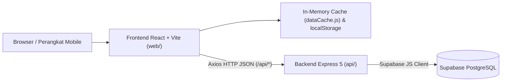
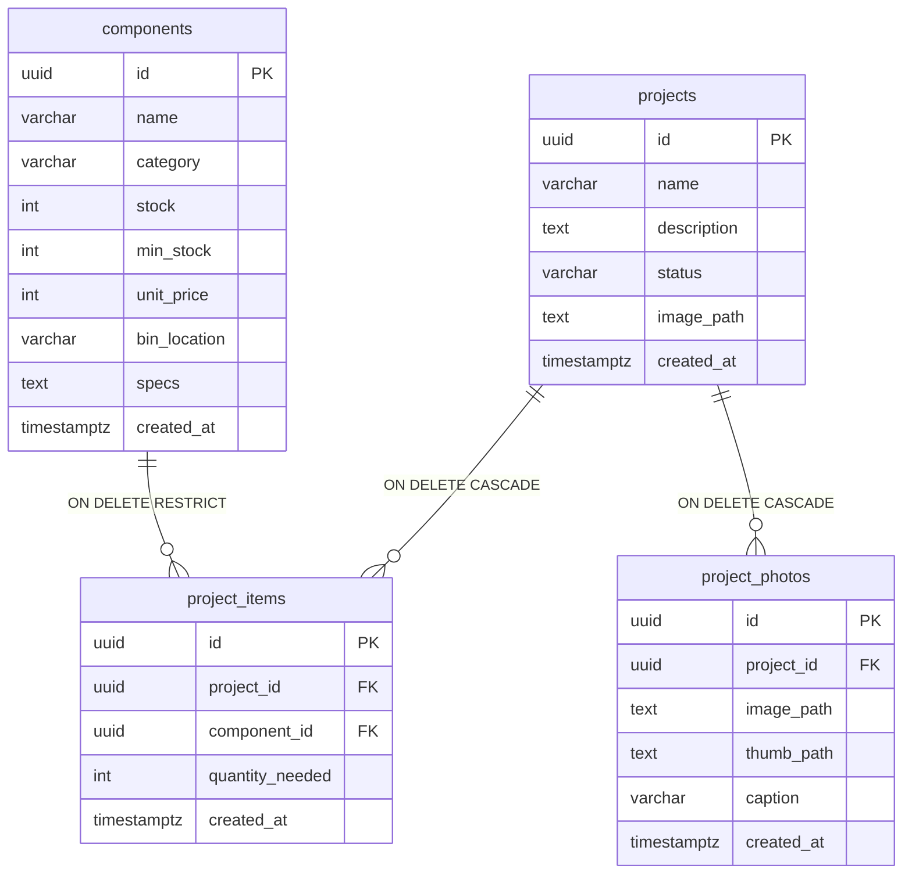

# PartsBin — Katalog Komponen Mikro & Kalkulator BOM Proyek Elektronika

**Tugas Akhir Praktikum Pemrograman Perangkat Bergerak (PPB) Ganjil 2026**

- **Pembuat**: Robertus William Susanto (`21120124120007`)
- **Program Studi**: Teknik Komputer, Universitas Diponegoro
- **Repositori GitHub**: https://github.com/RobertusWilliamSusanto/partsbin
- **URL Produksi Frontend**: https://partsbin-web.vercel.app
- **URL Produksi Backend API**: https://partsbin-api.vercel.app/api

---

## 1. Deskripsi Aplikasi

PartsBin adalah aplikasi web responsif berbasis React + Vite dan Express 5 + Supabase (PostgreSQL) untuk mengelola inventaris komponen elektronika pribadi (lokasi laci, jumlah stok, stok minimum, harga satuan, dan spesifikasi teknis) yang terintegrasi langsung dengan kalkulator **Bill of Materials (BOM)** proyek elektronika.

Sistem desain menggunakan pendekatan **Technician's Bench Notebook** (*Precision Cobalt Slate*, mode terang/gelap bebas kedip, kontras WCAG AA/AAA >= 4.5:1, permukaan solid bebas beban GPU, dan dual-layout Mobile `< 768px` serta Desktop `>= 768px`).

---

## 2. Fitur Utama & Kalkulator BOM

1. **Dashboard Meja Kerja (`/`)**: Menampilkan seluruh daftar proyek dengan filter status live (Semua, Direncanakan, Dikerjakan, Selesai; tersinkronisasi `?status=`), kartu proyek dengan thumbnail rasio 4:3 (`ProjectCover`), `StatusChip`, progress bar kesiapan rakit BOM, dan pagination client-side (`pageSize: 6`).
2. **Katalog Komponen (`/components`) & Detail (`/components/:id`)**:
   - Pencarian & filter kategori + filter "Stok Menipis" secara instan di browser (*client-side filtering*).
   - Stepper koreksi stok cepat `-1 / +1` melalui `PATCH /api/components/:id/stock`.
   - Panel form inline collapsible (`ComponentInlineForm.jsx`) dengan auto-save draf ter-debounce 400ms (`localStorage`) pada mode tambah serta inline edit pada halaman detail.
   - Proteksi `ON DELETE RESTRICT` (`409 Conflict`) bila komponen masih terdaftar pada BOM proyek, lengkap dengan daftar `used_in_projects`.
   - Pagination client-side (`usePagination`, `pageSize: 6`, tersinkronisasi `?page=`).
3. **Kalkulator BOM (`/calculator`) & Detail Proyek (`/projects/:id`)**:
   - **Perencanaan Proyek & BOM (`/calculator`)**: Pemilihan komponen inventaris + jumlah kebutuhan dengan live kalkulasi estimasi biaya dan kesiapan rakit BOM.
   - **Detail Proyek (`/projects/:id`)**: Dokumentasi sampul rasio 4:3 (`ProjectCover`), pengubah status pengerjaan fisik 3 tombol (`planned`, `in_progress`, `done`), kartu kesiapan rakit (*Build Readiness %*), daftar item BOM, penambahan item komponen, dan kartu daftar belanja (*Shopping Deficit*).
   - Rute `/projects` dialihkan otomatis (`Navigate replace`) ke `/`.
   - **Kalkulator Kesiapan Rakit (*Build Readiness %*) & Daftar Belanja (*Shopping Deficit*)**:
     - `is_low_stock = stock <= min_stock`
     - `shortage_qty = Math.max(0, quantity_needed - stock_available)`
     - `is_enough = shortage_qty === 0`
     - `readiness_percent = total_items === 0 ? 0 : Math.round((ready_items_count / total_items) * 100)`
     - `total_bom_cost = sum(quantity_needed * unit_price)`
     - `missing_cost = sum(shortage_qty * unit_price)`
   - Inline edit informasi proyek, tambah/hapus item BOM, serta konfirmasi hapus destruktif melalui `ConfirmModal.jsx`.
4. **Profil & Tentang (`/profile`)**: Identitas pembuat, kontrol tema terang/gelap, status koneksi jaringan (`useOnlineStatus`), status draf tersimpan, serta ringkasan arsitektur dan rumus BOM.
5. **Sinkronisasi Cache Lintas-Hook (`dataCache.js`)**: Setiap mutasi stok/data komponen otomatis meng-invalidasi cache proyek (agar `readiness_percent` dan `shopping_list` selalu akurat saat pindah tab), dan setiap mutasi proyek/item BOM otomatis meng-invalidasi cache detail komponen (`used_in_projects`).
6. **Dukungan Offline-First & Sinkronisasi Otomatis (IndexedDB + Outbox FIFO)**: Pengguna dapat membaca dan memodifikasi data (buat/edit/hapus komponen, koreksi stok via stepper, buat proyek kalkulator beserta BOM, dan ubah status proyek) saat perangkat offline. Seluruh operasi disimpan lokal di IndexedDB dan diantrekan pada outbox, lalu otomatis disinkronkan ke server secara berurutan saat internet kembali aktif.
7. **Dokumentasi Foto Proyek & Ekspor Dokumen PDF A4 (`/projects/:id`)**: Dokumentasi multi-foto per proyek hingga 60 foto (galeri grid 2 kolom rasio 4:3, paginasi klien 12 foto per batch, kompresi klien < 200 KB & rendisi thumbnail WebP <= 80 KB via HTML5 Canvas, antrean unggah sekuensial tahan gangguan jaringan, viewer dialog modal native, edit caption inline maks 200 karakter). Tombol **Unduh PDF** langsung men-generate dan mengunduh berkas biner `.pdf` resmi ke penyimpanan lokal tanpa memicu dialog printer desktop (didukung lazy-loaded chunk `jsPDF` hemat bundle), serta tombol **Cetak Dokumen** untuk cetak fisik via stylesheet cetak `@media print` murni.
8. **Peringatan Stok Menipis Real-Time (`dataCache.js` & `stock.js`)**: Pola in-memory pub-sub ringan (`subscribeComponents`) menyinkronkan counter badge `BottomNav` dan chip status secara instan tanpa perlu refresh halaman saat stok diubah melalui stepper, dengan rumus terpusat `isLowStock = stock <= min_stock`.
9. **Pemuatan Malas Galeri Foto Presisi (`LazyImage.jsx`)**: Menggunakan `IntersectionObserver` bersama (`rootMargin: "200px 0px"`) untuk mencegah browser memuat 12 foto sekaligus di luar viewport mobile (mengurangi request awal dari 13 menjadi 5), didukung container `aspect-ratio: 4 / 3` (CLS = 0) dan batching mutasi unggah sekuensial.

---

## 3. Arsitektur Sistem & ERD

### Diagram Arsitektur



### Entity Relationship Diagram (4 Tabel)



---

## 4. Struktur Folder Monorepo

```text
partsbin/
├── .gitignore
├── README.md
├── api/
│   ├── sql/
│   │   ├── schema.sql
│   │   ├── seed.sql
│   │   └── migration_v4.sql
│   ├── src/
│   │   ├── config/supabaseClient.js
│   │   ├── models/{componentModel.js, projectModel.js, projectItemModel.js}
│   │   ├── controllers/{componentController.js, projectController.js}
│   │   ├── routes/{componentRoutes.js, projectRoutes.js}
│   │   ├── middlewares/{errorHandler.js, upload.js}
│   │   └── index.js
│   ├── requests.http
│   ├── vercel.json
│   ├── .env.example
│   └── package.json
└── web/
    ├── src/
    │   ├── config/{api.js, profile.js}
    │   ├── services/{componentService.js, projectService.js}
    │   ├── hooks/{useComponents.js, useProjects.js, useOnlineStatus.js, useTheme.js}
    │   ├── utils/{dataCache.js, draftStorage.js, format.js, paginate.js, bom.js, chunkReload.js, safeOffline.js}
    │   ├── components/
    │   │   ├── modals/ConfirmModal.jsx
    │   │   ├── RouteErrorBoundary.jsx
    │   │   ├── ComponentInlineForm.jsx
    │   │   ├── TopBar.jsx
    │   │   ├── BottomNav.jsx
    │   │   ├── FilterBar.jsx
    │   │   ├── Pagination.jsx
    │   │   ├── StatusChip.jsx
    │   │   ├── ProjectCover.jsx
    │   │   ├── ProjectStatusChanger.jsx
    │   │   ├── ProjectReadinessCard.jsx
    │   │   ├── ProjectShoppingCard.jsx
    │   │   ├── PWABadge.jsx
    │   │   └── ThemeToggle.jsx
    │   ├── pages/
    │   │   ├── DashboardPage.jsx          (Route: /)
    │   │   ├── ComponentListPage.jsx      (Route: /components)
    │   │   ├── ComponentDetailPage.jsx    (Route: /components/:id)
    │   │   ├── ProjectCreatePage.jsx      (Route: /calculator)
    │   │   ├── ProjectDetailPage.jsx      (Route: /projects/:id)
    │   │   └── ProfilePage.jsx            (Route: /profile)
    │   ├── App.css
    │   ├── App.jsx
    │   ├── index.css
    │   └── main.jsx
    ├── index.html
    ├── vite.config.js
    ├── .env.example
    └── package.json
```

---

## 5. Pemetaan Aturan Wajib Asprak -> Bukti Implementasi

| Kode | Aturan Wajib Asprak | Status Verifikasi | Bukti Implementasi di Aplikasi |
| :---: | :--- | :---: | :--- |
| **R1** | Tugas individu | MANUAL OLEH PRAKTIKAN | Pengerjaan mandiri oleh Robertus William Susanto (NIM: 21120124120007). |
| **R2** | Platform: Progressive Web App / PWA (`React` + `Vite` + `vite-plugin-pwa`, service worker, manifest, installable, offline runtime caching) | TERVERIFIKASI (KODE & BUILD) | Ikon PWA maskable (`icon-192.png`, `icon-512.png`), `vite-plugin-pwa`, `dist/sw.js`, `dist/manifest.webmanifest`, offline guard (`useOnlineStatus`), serta runtimeCaching `partsbin-api-cache` (NetworkFirst) dan `partsbin-images` (CacheFirst). |
| **R3** | Memakai REST API (web service) buatan sendiri mengikuti arsitektur Modul 1 (`Express 5` + `Supabase`, folder `api/src/{config,routes,controllers,models}`, requests.http ada, web/src bersih dari supabase-js) | TERVERIFIKASI (KODE) | `api/src/config/supabaseClient.js`, `api/src/routes/`, `api/src/controllers/`, `api/src/models/`, `api/src/middlewares/errorHandler.js`, `api/requests.http`, `web/src/` bebas dari `@supabase/supabase-js`. |
| **R4** | Memiliki *Bottom Navigation Bar* (*mobile-first*) yang terpasang konsisten di seluruh rute utama | TERVERIFIKASI (KODE) | `web/src/components/BottomNav.jsx` (4 tab: Dashboard, Komponen, Kalkulator, Profil; aktif di seluruh lebar layar dengan container `max-width: 480px` terpusat), `web/src/App.css`. |
| **R5** | Minimal 5 halaman fungsional (PartsBin memiliki 6 rute halaman fungsional) | TERVERIFIKASI (KODE) | `web/src/App.jsx`: `/`, `/components`, `/components/:id`, `/calculator`, `/projects/:id`, `/profile`. |
| **R6** | Minimal 2 halaman utama berisi *list*, setiap item bisa diklik menuju halaman *detail* | TERVERIFIKASI (KODE) | List 1: `/components` -> `/components/:id` (`ComponentListPage.jsx` -> `ComponentDetailPage.jsx`); List 2: Dashboard `/` -> `/projects/:id` (`DashboardPage.jsx` -> `ProjectDetailPage.jsx`). |
| **R7** | Memiliki 1 halaman *Profile/About* (`/profile`) | TERVERIFIKASI (KODE) | `web/src/pages/ProfilePage.jsx` + data sumber tunggal `web/src/config/profile.js`. |
| **R8** | Seluruh *source code* wajib tersimpan di repositori GitHub publik | MENUNGGU PUSH (MANUAL OLEH PRAKTIKAN) | https://github.com/RobertusWilliamSusanto/partsbin (menunggu push manual oleh praktikan ke branch `main`). |
| **R9** | Judul dan topik tidak boleh sama dengan praktikan lain di platform yang sama | MANUAL OLEH PRAKTIKAN | Topik: Katalog Komponen Mikro & Kalkulator BOM Proyek Elektronika. |
| **R10** | Mengikuti asistensi minimal 1x dan mengisi lembar asistensi | MANUAL OLEH PRAKTIKAN | Dijadwalkan sebelum batas akhir asistensi. |
| **R11** | PWA wajib di-deploy di free hosting (Vercel); tautan repositori dicantumkan di kolom GitHub | MENUNGGU DEPLOY | `web/vercel.json` dan deploy produksi 2 project di Vercel dikerjakan setelah pengerjaan frontend tuntas. |
| **R12** | Rentang pengerjaan 13–24 Nov 2026, responsi 25–28 Nov 2026; dilarang Protect Cell sebelum memiliki judul | MANUAL OLEH PRAKTIKAN | Jadwal pengerjaan dipatuhi oleh praktikan. |

### Batasan Sadar & Keamanan Sistem
1. **API Tanpa Autentikasi**: Sesuai dengan spesifikasi tugas akhir PPB dasar, seluruh 16 endpoint REST API dirancang tanpa mekanisme login/autentikasi (berlaku sebagai sistem inventaris meja kerja bersama / *shared workshop bench*).
2. **Keamanan Supabase Storage**: Bucket `project-images` diakses menggunakan Supabase anon key yang secara ketat HANYA dipegang dan dikelola oleh backend API (`api/src/config/supabaseClient.js`). Frontend `web/` sama sekali tidak memiliki akses kredensial Supabase maupun SDK `@supabase/supabase-js`, dan operasi penyimpanan diamankan melalui RLS policy Supabase Storage (`storage.objects`).

---

## 6. Spesifikasi 16 Endpoint REST API (`/api`)

| No | Method | Path | Sukses | Gagal |
| :- | :--- | :--- | :---: | :---: |
| 1 | `GET` | `/api/health` | `200` | - |
| 2 | `GET` | `/api/components` | `200` | `500` |
| 3 | `GET` | `/api/components/:id` | `200` | `400`, `404` |
| 4 | `POST` | `/api/components` | `201` | `400` |
| 5 | `PUT` | `/api/components/:id` | `200` | `400`, `404` |
| 6 | `PATCH` | `/api/components/:id/stock` | `200` | `400`, `404` |
| 7 | `DELETE` | `/api/components/:id` | `200` | `400`, `404`, `409` |
| 8 | `GET` | `/api/projects` | `200` | `500` |
| 9 | `GET` | `/api/projects/:id` | `200` | `400`, `404` |
| 10 | `POST` | `/api/projects` | `201` | `400` |
| 11 | `PUT` | `/api/projects/:id` | `200` | `400`, `404` |
| 12 | `DELETE` | `/api/projects/:id` | `200` | `400`, `404` |
| 13 | `POST` | `/api/projects/:id/items` | `201` | `400`, `404`, `409` |
| 14 | `DELETE` | `/api/projects/:id/items/:itemId` | `200` | `400`, `404` |
| 15 | `PATCH` | `/api/projects/:id/status` | `200` | `400`, `404` |
| 16 | `POST` | `/api/projects/:id/image` | `200` | `400`, `404`, `413` |
| 17 | `POST` | `/api/projects/:id/photos` | `201` | `400`, `404`, `413` |
| 18 | `PATCH` | `/api/projects/:id/photos/:photoId` | `200` | `400`, `404` |
| 19 | `DELETE` | `/api/projects/:id/photos/:photoId` | `200` | `400`, `404` |

### Contoh Pengujian `curl` (Teks Polos)

```text
curl -s https://partsbin-api.vercel.app/api/health
curl -s https://partsbin-api.vercel.app/api/components
curl -s https://partsbin-api.vercel.app/api/projects
curl -s -X POST http://localhost:3000/api/components
curl -s -X PATCH http://localhost:3000/api/components/UUID_KOMPONEN/stock -H "Content-Type: application/json" -d '{"stock": 10}'
```

---

## 7. Panduan Setup Lokal & Deploy Vercel

### A. Setup Database Supabase
1. Buka Supabase SQL Editor.
2. Jalankan `api/sql/schema.sql` untuk membuat tabel `components`, `projects`, dan `project_items`.
3. (Opsional untuk data awal) Jalankan `api/sql/seed.sql` (perhatikan skrip ini menjalankan `TRUNCATE`).

### B. Menjalankan Backend (`api/`)
1. Salin `api/.env.example` menjadi `api/.env` lalu isi:
   - `PORT=3000`
   - `SUPABASE_URL=https://project-id.supabase.co`
   - `SUPABASE_KEY=supabase-anon-key`
   - `CORS_ORIGINS=http://localhost:5173,https://partsbin-web.vercel.app` (atau `FRONTEND_URL`)
2. Jalankan:
   ```text
   cd api
   npm install
   npm run dev
   ```
   Backend berjalan pada http://localhost:3000/api.

### C. Menjalankan Frontend (`web/`)
1. Salin `web/.env.example` menjadi `web/.env` lalu isi:
   - `VITE_API_BASE_URL=http://localhost:3000/api`
2. Jalankan:
   ```text
   cd web
   npm install
   npm run dev
   ```
   Frontend berjalan pada http://localhost:5173.

### D. Deploy 2 Project Vercel dari 1 Monorepo
1. **Project Backend (`partsbin-api`)**:
   - Root Directory: `api`
   - Environment Variables: `SUPABASE_URL`, `SUPABASE_KEY`, `FRONTEND_URL=https://partsbin-web.vercel.app`
   - URL hasil deploy: https://partsbin-api.vercel.app/api
2. **Project Frontend (`partsbin-web`)**:
   - Root Directory: `web`
   - Framework Preset: Vite (`npm run build`, Output Directory: `dist`)
   - Environment Variables: `VITE_API_BASE_URL=https://partsbin-api.vercel.app/api`
   - URL hasil deploy: https://partsbin-web.vercel.app

### E. Uji Preview Produksi & Offline
1. Jalankan `npm run build` lalu `npm run preview -- --host` di dalam folder `web/`.
2. Buka http://localhost:4173 di Chrome/Edge, buka DevTools -> tab **Application** -> **Service Workers** (gunakan tombol **Unregister** bila ingin membersihkan cache pengujian lama) dan uji toggle **Offline** di tab **Network**.

### F. Urutan Deploy Fitur Dokumentasi Kuota 60 Foto & Thumbnail (v5.3)
1. **Migrasi Database**: Jalankan skrip berikut di Supabase SQL Editor secara berurutan:
   - `api/sql/migration_v5.sql` (bila belum pernah dijalankan: membuat tabel `project_photos`).
   - `api/sql/migration_v5_2.sql` (membatalkan trigger database v5.1 agar arsitektur bersih tanpa trigger).
   - `api/sql/migration_v5_3.sql` (menambahkan kolom `thumb_path TEXT` untuk thumbnail).
2. **Deploy Backend API**: Deploy direktori `api/` ke Vercel dan uji endpoint #17-#19 menggunakan `requests.http`.
3. **Deploy Frontend PWA**: Deploy direktori `web/` ke Vercel setelah backend API terbukti aktif.

> **Catatan Responsi Terkait Urutan Deploy**:
> - Jika backend API di-deploy mendahului migrasi SQL, query foto memiliki mekanisme *fail-safe* `try/catch` yang mengembalikan `photos: []`, sehingga API tidak pernah mematikan halaman detail proyek.
> - Jika web di-deploy mendahului backend API, bagian foto di halaman detail akan menampilkan pesan informatif / empty state saat memanggil endpoint yang belum tersedia.

---

## 8. Catatan Keamanan & Batasan Lingkup Praktikum

Aplikasi PartsBin dirancang dengan postur keamanan yang disesuaikan untuk tugas praktikum:
1. **Frontend Bersih dari Kunci API**: Klien browser murni berkomunikasi dengan backend Express via Axios JSON. Kunci Supabase tidak pernah di-bundle ke dalam build frontend.
2. **Validasi File & Input Ketat**: Unggahan foto proyek diperiksa menggunakan inspeksi *magic bytes* biner in-memory (`memoryStorage`) tanpa menyentuh disk serverless, dibatasi 2 MB, dan parameter rute divalidasi format UUID secara terpusat (`validateUuid.js`).
3. **Ketahanan Update PWA & Stale Chunk**: Aplikasi menerapkan penanganan kegagalan chunk modul otomatis (`vite:preloadError` dengan throttle 10 detik `sessionStorage`), rute boundary cadangan (`RouteErrorBoundary`), pengecualian rewrite `/assets/` pada Vercel (mengembalikan 404 asli alih-alih 200 `text/html`), serta *fail-open* timeout 2500ms pada modul offline sehingga transisi update tidak pernah membekukan aplikasi.
4. **Keterbatasan yang Diketahui untuk Praktikum**: Endpoint API tidak dipasangi sistem login/token pengguna untuk memenuhi kepatuhan arsitektur Modul 1 dan memudahkan pengujian langsung oleh asisten praktikum saat responsi. Kebijakan CORS membatasi akses lintas browser, namun request server-ke-server langsung (seperti `curl`) tetap dapat menjangkau endpoint API publik.

---

## 9. Checklist Asistensi Asprak

- [ ] URL Deploy Frontend aktif: https://partsbin-web.vercel.app
- [ ] URL Deploy Backend aktif: https://partsbin-api.vercel.app/api/health
- [ ] Link Repositori GitHub Public: https://github.com/RobertusWilliamSusanto/partsbin
- [ ] Lembar asistensi siap ditandatangani.
- [ ] **3 Bahan Diskusi Responsi dengan Asisten**:
  1. **Alasan memilih `react-router-dom` (7 rute) dibanding navigasi `useState` Modul 4**: Setiap halaman detail (`/components/:id`, `/projects/:id`) dan form unified (`/projects/new`) memiliki URL unik yang bisa di-bookmark serta mendukung tombol *Back* bawaan perangkat pada mode PWA *standalone*.
  2. **Arsitektur monorepo 2 project Vercel (`api/` dan `web/`)**: Memisahkan siklus deploy backend Express serverless dan frontend static/SPA tanpa memecah riwayat Git, dengan CORS origin whitelist melalui `FRONTEND_URL`.
  3. **Penanganan error Express 5 & guard `req.body ?? {}`**: Express 5 menangkap rejection fungsi `async` secara otomatis ke `errorHandler.js` (memetakan `PGRST116` -> 404, `23503` saat `DELETE` -> 409 `ON DELETE RESTRICT`, `23505` -> 409 duplikat BOM, `22P02` -> 400 UUID tidak valid), sementara `const body = req.body ?? {}` mencegah `TypeError` ketika request `POST`/`PUT`/`PATCH` dikirim tanpa body.
